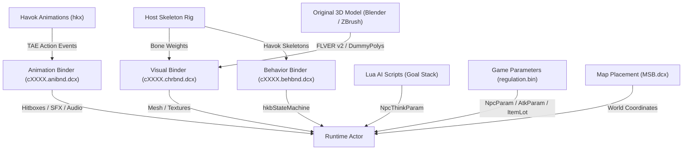

# Elden Ring: Original Monster Creation & EnemyForge Extension Architecture

**Date**: 2026-10-12  
**Author**: The Order Agentic System  
**Target Engine**: FromSoftware Dantelion / Havok Engine (*Elden Ring* v1.12+ / *Shadow of the Erdtree*)  
**Target Repository**: `Projects/modding/FromSoftware/Elden Ring/EnemyForge`  

---

## 1. Executive Summary & The Core Challenge

The current architecture of **EnemyForge** focuses on humanoid player-character models (`c0000`). It translates character presets into hostile Tarnished roaming enemies, invaders, and duelists, automatically populating `NpcParam`, `ChrAsmParam`, `FaceParam`, and `ItemLotParam_enemy` (guaranteed carried loot drops).

Expanding EnemyForge to forge **"actual original monsters"** (quadrupeds, beasts, chimeric abominations, dragons, eldritch horrors, multi-limbed titans) transitions the engine from standard NPC parameter manipulation into **full-pipeline entity construction**.

In FromSoftware's engine, an enemy is not a single file—it is a tightly synchronized distributed network of 7 distinct subsystems:



---

## 2. The Five Tiers of Monster Creation

Understanding what is technically feasible versus what is an engine brick wall is paramount. The Souls modding community categorizes creature modding into five distinct tiers:

| Tier | Technique | Visual Originality | Behavioral Originality | Feasibility & Stability | Used By |
| :--- | :--- | :--- | :--- | :--- | :--- |
| **Tier 1: Humanoid Presets** | `c0000` NPC rigs with custom gear, face, stats, and loot | Low (Human Tarnished) | Moderate (Weapon movesets & AI) | 100% Native, Rock-solid | **EnemyForge** (Current) |
| **Tier 2: Creature Splicing & Overhauls** | Reusing vanilla monster models, re-skinning textures, splicing TAE animations & Lua AI | Moderate (Variant aesthetic) | High (New combos, elemental magic) | Highly Stable | *The Convergence*, *Elden Ring Reforged* |
| **Tier 3: Custom 3D Mesh on Host Rig** | 100% original 3D sculpt (Blender/ZBrush) rigged to a vanilla FromSoft creature skeleton | **100% Original** | High (Inherits polished moveset) | **Industry Standard for Original Monsters** | *Garden of Eyes*, *Archthrones*, *Nightfall* |
| **Tier 4: Custom Keyframe Animations** | Original mesh + custom authored `.hkx` animations injected via `ERClipGeneratorTool` | **100% Original** | **100% Original** | Complex, requires Havok tooling & TAE sync | Advanced Animation Modders |
| **Tier 5: 100% From-Scratch Skeleton & Havok Behavior** | Authoring a completely new bone hierarchy and new Havok state machine graph from zero | Unlimited | Unlimited | **Practically Impossible** (Engine Brick Wall) | Unsolved without FromSoft internal dev kits |

> [!IMPORTANT]
> **The Havok Behavior "Brick Wall" Explained:**  
> Why doesn't any overhaul mod (even million-download mods like *The Convergence*) make skeletons completely from scratch?  
> FromSoftware compiles Havok Behavior graphs (`.behbnd.dcx`) containing thousands of binary state nodes: blend spaces, ragdoll physics capsules, foot inverse kinematics (IK) raycasts, flinch thresholds, and stagger states. Creating a new behavior graph from zero without FromSoft's proprietary project workspaces results in immediate crash-to-desktop or static T-pose mannequins with no collision or locomotion.  
> **The Universal Solution:** Modders use **Rig Hosting (Tier 3 & Tier 4)**: A 100% original 3D creature sculpt is weighted to an existing FromSoft creature skeleton (e.g., Runebear, Bloodhound Knight, Troll, Erdtree Avatar, Dragon, Leonine Misbegotten). It looks entirely like a brand new monster, but inherits flawless physics, ragdolls, and locomotion!

---

## 3. The Seven Pillars of a Monster in Elden Ring

To forge an original creature, seven architectural layers must be authored and synchronized:

### Pillar 1: The 3D Mesh & Materials (`cXXXX.chrbnd.dcx`)
- **Container**: `chr/cXXXX.chrbnd.dcx` (where `XXXX` is a unique standalone 4-digit Chr ID, e.g., `c9200`).
- **Format**: `FLVER v2` (FromSoftware Model Format).
- **Submeshes & Buffers**: Vertices, Normals, Tangents, UV maps, Vertex Colors, and Bone Weights (max 4 weights per vertex for standard meshes).
- **Textures (`.tpf.dcx`)**: DirectDraw Surface (`.dds`) using BC7 (Albedo, Emissive) and BC5 (Normals):
  - `_a`: Albedo / Base Color
  - `_n`: Normal map
  - `_m`: Metallic / Roughness / Ambient Occlusion
  - `_e`: Emissive glow mask
- **Materials (`.matbin`)**: Material binary files defining shader assignments, rim lighting, and transparency.

### Pillar 2: The DummyPoly System (The Monster's "Invisible Organs")
DummyPolys are precise 3D reference points anchored to specific bones. Without DummyPolys, a monster is broken:
- **ID 200**: **Camera Lock-on Point**. Where the player's camera targets when locking on.
- **ID 220**: **Head / Eye Level**. Determines enemy line-of-sight and projectile aim.
- **ID 100 / 101**: **Right / Left Hand Grip Points**. Where held weapons, torches, or special blades attach.
- **ID 800 - 809**: **Blood & Impact VFX**. Where blood splatters and sparks spawn when hit by player attacks.
- **ID 900 - 920**: **VFX & Breath Anchors**. Where breath attacks (fire, frost, rot), roars, eye glints, and ground shockwaves spawn.

### Pillar 3: Skeletons & Rigging
- The bone hierarchy in the FLVER **must exactly match** the bone names and indices of the host Havok skeleton.
- Common Host Rig Archetypes:
  - `c4000`: Wolf / Hound (Quadruped agile beast)
  - `c4320`: Runebear (Massive quadruped brute)
  - `c4200`: Troll / Giant (Towering bipedal colossus)
  - `c4520`: Erdtree Avatar / Asylum Demon (Heavy club-wielding brute)
  - `c2010`: Bloodhound Knight (Agile curved-sword stalker)
  - `c4400`: Leonine Misbegotten (Feral leaping biped)
  - `c4700`: Flying Dragon / Wyvern (Massive winged aerial beast)
  - `c3300`: Astel / Fallingstar Beast (Multi-segmented eldritch entity)

### Pillar 4: Action Timelines & Hitboxes (TAE in `cXXXX.anibnd.dcx`)
Animations alone do not inflict damage. In FromSoftware engines, animations are dumb timelines; **TAE (Time Act Events)** dictates gameplay:
- **Event 1 (Hitbox Active)**: Specifies start/end frame, dummy poly radius, damage type, and `AtkParam` slot.
- **Event 2 (Jump Table / Cancel Window)**: Allows the monster to transition into combos or flinch.
- **Event 16 (SpEffect Application)**: Applies super armor, hyper armor, invulnerability, or poise shields during wind-ups.
- **Event 32 (SFX Spawn)**: Spawns visual effects (fire claws, lightning trails, rot dust) attached to dummy polys.
- **Event 33 (Sound FX)**: Plays sound effects (roars, ground stomps, blade whooshes).
- **Event 96 / 128 (Camera Shake / Physics)**: Triggers screen tremors on heavy slams.

### Pillar 5: Behavior State Machine (`cXXXX.behbnd.dcx`)
- Compiled Havok Behavior graph (`hkbStateMachine`, `hkbClipGenerator`).
- Controls locomotion blending: turning in place, walk/run transitions, staggering on poise break, and death animations.
- **Tool**: `ERClipGeneratorTool` or `HKLib` allows registering new animation clip IDs into an existing host's behavior graph without corrupting the state tree.

### Pillar 6: Artificial Intelligence Brain (Lua Goal Stack + `NpcThinkParam`)
- **Engine Logic**: Stored in `script/ai/out/bin/*.luabnd.dcx`.
- **Architecture**: FromSoftware uses a **Pushdown Goal Automaton** written in Lua 5.1 bytecode:
  - `GOAL_COMMON_Attack`: Executes specific attack behaviors.
  - `GOAL_COMMON_Combo`: Chains attacks into multi-hit combos.
  - `GOAL_COMMON_KeepDist`: Backsteps, circles, or maintains optimal combat distance.
  - `GOAL_COMMON_Turn`: Aligns facing direction toward the target.
- **Input Reading**: AI scripts hook into player actions:
  - Flask chugging -> Triggers instant gap-closer thrust.
  - Spell casting -> Triggers side-dodge or leap attack.
- **`NpcThinkParam` (regulation.bin)**:
  - Sets visual sight distance, hearing radius, aggro retention duration, and binds the AI script ID (`aiId`).

### Pillar 7: Game Parameters & Scaling (`regulation.bin`)
- **`NpcParam`**: Defines HP, MP, stamina, physical/elemental defense splits, status resistances (Bleed, Frost, Rot, Poison, Sleep, Madness), poise threshold, model ID (`chr_id`), and loot drop ID (`itemLotId_enemy`).
- **`BehaviorParam_NPC`**: Maps AI decision triggers to specific TAE animation IDs.
- **`AtkParam_Npc`**: Defines precise damage values, stamina drain, poise damage, pushback distance, and status buildup for every swing.
- **`SpEffectParam`**: Passive traits (e.g., fiery aura that burns players in proximity, health regeneration, enraged phase triggers).
- **`ItemLotParam_enemy`**: 100% drop rate tables for signature monster drops.

---

## 4. End-to-End Pipeline for Creating an Original Monster

Here is the exact step-by-step production workflow used to create and inject an original creature:

```
[1. Concept & 3D Sculpt] (Blender / ZBrush)
          │
[2. Skeleton Alignment] (Import Host FLVER Skeleton via Soulstruct)
          │
[3. Weight Painting & DummyPolys] (Skin mesh to bones; place DummyPolys 200, 220, 800+, 900+)
          │
[4. FLVER & DDS Export] (Export FLVER v2 + BC7/BC5 textures -> WitchyBND into cXXXX.chrbnd.dcx)
          │
[5. Moveset & TAE Tuning] (DSAnimStudio: adjust hitboxes, add SFX/sound, custom combo timings)
          │
[6. Param Generation] (Smithbox / RegTool: generate unique NpcParam, NpcThinkParam, AtkParam)
          │
[7. World Spawning] (MSB Map Injection: place standalone MSB Enemy Part at target coordinates)
```

---

## 5. Architectural Blueprint: Extending EnemyForge into "Monster Forge"

To evolve **EnemyForge** from a humanoid preset injector into a comprehensive creature creation engine, we propose the following multi-phase architectural roadmap:

### Phase 1: Creature Host Archetype Catalog
Create a rich catalog of host rig templates in `src/creatures/archetypes.py`:
- **Beast Archetype (`c4000` / `c4320`)**: Quadrupeds (wolves, bears, lions).
- **Brute Archetype (`c4200` / `c4520`)**: Towering bipedal heavy hitters (giants, trolls, avatars).
- **Stalker Archetype (`c2010`)**: Agile, acrobatic humanoid monsters (Bloodhound Knights, Black Knives).
- **Aberration Archetype (`c4400`)**: Feral chimeras and leaping beasts (Misbegotten, Omens).
- **Draconic Archetype (`c4700`)**: Winged beasts and wyverns.

Each archetype entry specifies:
```python
@dataclass(frozen=True)
class CreatureArchetype:
    archetype_id: str
    base_chr_id: int              # e.g., 4200 (Troll)
    bone_list: tuple[str, ...]    # Verified bone names
    dummy_poly_map: dict[str, int]# 200=LockOn, 220=Eyes, 100=RightHand
    base_npc_param_template: int  # Vanilla template row
    base_think_param_template: int
    signature_animations: tuple[int, ...]
```

### Phase 2: Standalone Chr ID Allocator & Binder Cloner
- Prevent overwriting vanilla enemies.
- Allocate standalone IDs in the safe range (`c9100` - `c9499`).
- Automated tooling to clone and retarget the base `.chrbnd.dcx`, `.anibnd.dcx`, and `.behbnd.dcx` to the new ID without manual file juggling.

### Phase 3: Monster Param & Combat Scaling Synthesizer
Extend the C# `RegTool` and Python engine to automatically generate:
- **Level-Scaled `NpcParam`**: Dynamic calculation of HP (1,000 - 30,000), Poise (50 - 250), Defenses, and Status Resistances based on user-selected tier (Miniboss, Roaming Terror, Legendary World Boss).
- **Elemental Affinities & Auras**: Automatically generate `SpEffectParam` and inject elemental damage splits into `AtkParam_Npc` (e.g., turning physical beast claws into Scarlet Rot, Frostbite, or Blackflame strikes).
- **AI Aggression Profiles (`NpcThinkParam`)**: Sliders for reaction speed, vision range, and combat aggression.

### Phase 4: Monster Loot Forge ("They Drop What They Are")
Just as EnemyForge guarantees carried weapon/armor drops for humanoids:
- **Creature Trophies & Remembrances**: Defeating custom monsters drops their unique boss remembrance, beast talismans, rare craftable materials (ancient dragon stones, larval tears, exalted flesh), or monstrous signature weapons.
- Automatically populated into `ItemLotParam_enemy`.

### Phase 5: Blender Starter Kits & Automation Hooks
- Provide pre-rigged `.blend` starter files with FromSoft skeletons and DummyPoly empties pre-positioned.
- Export scripts that automatically convert `.blend` to `.flver` and package into ModEngine-ready folder structures.

---

## 6. Verification & Safety Contract

Any monster addition to EnemyForge must uphold The Order's core invariants:
1. **Zero Vanilla Replacement (`[CS-MODULAR]`)**: All forged monsters must use standalone IDs (`c9100+`, `NpcParam 9500000+`) to guarantee zero mod conflicts.
2. **1-Click Rollback (`[CS-SAFETY]`)**: All injected rows and files must be registered in `enemyforge_manifest.json` and backed up with SHA-256 snapshots.
3. **No-Mock Verification (`[CS-NO-MOCK]`)**: Unit and integration tests must verify row creation, ID partitioning, and file integrity against real `regulation.bin` schemas.
