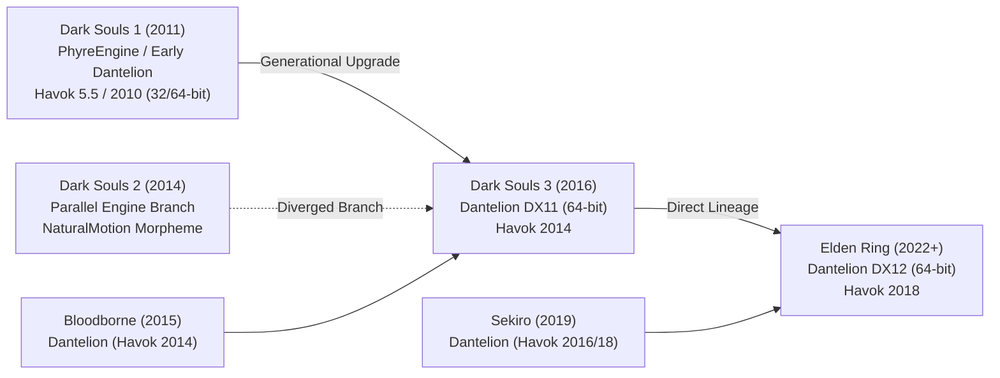

# FromSoftware Cross-Game Enemy Porting: Dark Souls 1, 2, and 3 to Elden Ring

**Date**: 2026-10-12  
**Author**: The Order Agentic System  
**Target Engine**: FromSoftware Dantelion / Havok Engine (*Elden Ring* v1.12+ / *Shadow of the Erdtree*)  
**Source Games**: *Dark Souls: Prepare to Die / Remastered* (DS1), *Dark Souls II: Scholar of the First Sin* (DS2), *Dark Souls III* (DS3)  
**Target Repository**: `Projects/modding/FromSoftware/Elden Ring/EnemyForge`  

---

## 1. Executive Summary & Engine Genealogy

Porting enemies, monsters, and bosses across FromSoftware's catalog into *Elden Ring* is a core ambition for major overhaul mods (*The Convergence*, *Archthrones*, *Nightfall*, *Garden of Eyes*). Because FromSoftware iteratively evolved their proprietary engine across titles, porting feasibility depends entirely on which engine branch the source game was built upon:



### Key Takeaway on Porting Difficulty:
1. **Dark Souls 3 $\rightarrow$ Elden Ring (Difficulty: Low / Moderate)**: Direct sibling engines. Skeletons, DummyPolys, TAE timelines, and Lua AI Goals are 90% identical. Primarily requires **Havok 2014 $\rightarrow$ 2018 conversion** and **MTD $\rightarrow$ MATBIN shader remapping**.
2. **Dark Souls 1 $\rightarrow$ Elden Ring (Difficulty: Moderate / High)**: Generational leap. Older FLVER mesh buffers, 28-bone limits, and Havok 2010 format require **Blender retargeting** or pairing with FromSoft's native Elden Ring evolutionary rigs (e.g., Asylum Demon $\rightarrow$ Erdtree Avatar).
3. **Dark Souls 2 $\rightarrow$ Elden Ring (Difficulty: High / Complex)**: The "Black Sheep." DS2 used a diverged engine utilizing **NaturalMotion Morpheme** instead of standard Havok Behavior. Animations cannot be converted directly; they must be extracted as **FBX motion curves** in Blender and re-baked onto Elden Ring Havok skeletons.

---

## 2. Technical Comparison Matrix Across Generations

| Subsystem | Dark Souls 1 (PTDE / DSR) | Dark Souls 2 (SotFS) | Dark Souls 3 | Elden Ring |
| :--- | :--- | :--- | :--- | :--- |
| **Engine Architecture** | PhyreEngine / Early FromSoft (32-bit PTDE, 64-bit DSR) | Custom Parallel Engine (Scholar DX11) | Dantelion Engine (DirectX 11, 64-bit) | Dantelion Engine (DirectX 12, 64-bit) |
| **3D Model (`.flver`)** | `FLVER 0` (PTDE) / `FLVER 2` (DSR); 28-38 bone limit per submesh | `FLVER 2` (Custom DS2 dialect, unique vertex buffers) | `FLVER 2` (Modern unified vertex layout) | `FLVER 2` (Exact same layout as DS3; minor flag updates) |
| **Shaders / Materials** | `.mtd` (DirectX 9 / 11) | `.mtd` (DS2-specific shader variables) | `.mtd` (DirectX 11 PBR shaders) | `.matbin` (DirectX 12 PBR shaders: Albedo, Normal, Metal/Roughness, Emissive) |
| **Textures** | TPF with DXT1/DXT5 DDS | TPF with DXT1/DXT5 DDS | TPF with DXT1/DXT5 / BC7 DDS | TPF with BC7 / BC5 DDS (`.tpf.dcx`) |
| **Havok Middleware** | **Havok 5.5 / 2010** | **Havok 2012 + Morpheme** | **Havok 2014** (64-bit) | **Havok 2018** (64-bit Tagfile/Packfile) |
| **Animation Container** | `cXXXX.anibnd` (`.hkx` clips + `.tae`) | `cXXXX.anibnd` / Morpheme runtime | `cXXXX.anibnd.dcx` (`.hkx` clips + `.tae`) | `cXXXX.anibnd.dcx` (`.hkx` clips + `.tae`) |
| **TAE (Time Act Events)** | TAE v1 (Legacy event IDs) | TAE v2 (DS2-specific event layout) | TAE v3 (Modern event layout) | TAE v3 (Elden Ring extension) |
| **Behavior Graph** | `cXXXX.behbnd` (Legacy Havok Behavior) | Custom State Machine | `cXXXX.behbnd.dcx` (Havok 2014 state machine) | `cXXXX.behbnd.dcx` (Havok 2018 state machine) |
| **AI Architecture** | Lua 5.0/5.1 scripts (`.lua`) + ESD | Proprietary Lua scripts + ESD | Lua 5.1 compiled bytecode (`.luabnd.dcx`) + `NpcThinkParam` | Lua 5.1 compiled bytecode (`.luabnd.dcx`) + `NpcThinkParam` |
| **Parameter Store** | `GameParam.parambnd` | `enc_regulation.bnd.dcx` | `Data0.bdt` / `regulation.bin` | `regulation.bin` (BND4 encrypted container) |

---

## 3. Playbook 1: Porting Dark Souls 3 Enemies to Elden Ring (Direct Lineage)

Dark Souls 3 and Elden Ring share the same foundational Dantelion codebase. Many Elden Ring creatures are direct evolutions or asset carry-overs from DS3 (e.g., Basilisks, Dogs, Rats, Crabs, Skeletons, and cut content like the Ulcerated Tree Spirit).

```
[DS3 cXXXX Assets]
   ├── cXXXX.chrbnd.dcx (FLVER + TPF) ──> [MTD to MATBIN + DDS to BC7] ──> [ER cYYYY.chrbnd.dcx]
   ├── cXXXX.anibnd.dcx (HKX + TAE)   ──> [Havok 2014 to 2018 + DSAnimStudio TAE Sync] ──> [ER cYYYY.anibnd.dcx]
   ├── cXXXX.behbnd.dcx (Behavior)    ──> [ERClipGeneratorTool Register] ──> [ER cYYYY.behbnd.dcx]
   └── Lua Scripts & Params           ──> [DSLuaDecompiler + RegTool Param Translate] ──> [ER regulation.bin]
```

### Step 1: 3D Model & Textures (`cXXXX.chrbnd.dcx`)
1. Unpack DS3's `chr/cXXXX.chrbnd.dcx` using **WitchyBND**.
2. **Material Remapping**:
   - DS3 FLVER models reference `.mtd` files (e.g., `M[ARSN]_cXXXX.mtd`).
   - Elden Ring requires `.matbin` files (e.g., `c_d_chr_standard.matbin`).
   - Open the FLVER in **Pear's FLVER Editor** or Blender: update material strings from `.mtd` to valid Elden Ring `.matbin` definitions.
3. **Texture Conversion**:
   - Extract `.dds` textures from the `.tpf.dcx`.
   - Ensure Diffuse/Albedo is BC7, Normal maps are BC5, and channel-pack Metallic/Roughness/AO.
   - Repack into `.tpf.dcx` with Elden Ring compression.
4. Rename binder to target standalone Chr ID (e.g., `c9300.chrbnd.dcx`).

### Step 2: Animations & Havok Conversion (`cXXXX.anibnd.dcx`)
1. Unpack DS3's `chr/cXXXX.anibnd.dcx`.
2. **Convert Havok 2014 to Havok 2018**:
   - DS3 `.hkx` animation clips cannot be run natively in Elden Ring (they cause instant CTD).
   - Use **Havok Content Tools 2018** (`FileConvert.exe`) or community scripts (`DS3HavokConverter` / `hkxconv`) to convert the Havok XML/binary files from the 2014 tagfile schema to 2018 tagfile schema.
   - Alternatively, import DS3 animations into Blender via `Soulstruct` and re-export as Elden Ring `.hkx`.
3. Repack converted `.hkx` files into `c9300.anibnd.dcx`.

### Step 3: Time Act Events (TAE)
1. Both DS3 and Elden Ring use TAE v3.
2. Open the source DS3 TAE and target Elden Ring TAE in **DSAnimStudio**.
3. **Remap Events**:
   - **Event 1 (Hitbox)**: Remap damage type flags and `AtkParam` references.
   - **Event 2 (Jump Table)**: Identical combo transitions.
   - **Event 16 (SpEffect)**: Update SpEffect IDs from DS3 IDs to Elden Ring equivalents (e.g., poise buffs, invulnerability).
   - **Event 32 (Visual Effects)**: Remap DS3 FFX particle IDs to Elden Ring FXR3 asset IDs.
   - **Event 33 (Audio)**: Remap sound bank IDs.

### Step 4: AI Logic & Parameters
1. Decompile DS3's `cXXXX_battle.lua` using **DSLuaDecompiler**.
2. Adapt DS3 Goal Stack commands (`GOAL_COMMON_Attack`, `GOAL_COMMON_Combo`) to Elden Ring's global Lua environment.
3. In `regulation.bin` (via C# `RegTool` or Smithbox):
   - Translate DS3 `NpcParam` row (health, damage negations, poise, resistances) into Elden Ring `NpcParam`.
   - Create `NpcThinkParam` matching DS3 aggro distance and reaction speeds.
   - Populate `AtkParam_Npc` with attack damage values.

---

## 4. Playbook 2: Porting Dark Souls 1 Enemies to Elden Ring (Generational Upgrade)

Dark Souls 1 was authored for 32-bit DirectX 9 hardware (PTDE) or refreshed in 64-bit (DSR). It uses Havok 2010 (5.5) and FLVER models constrained by legacy submesh bone limits (28–38 bones max).

### The Two Porting Strategies for DS1:

#### Strategy A: Direct Rig Pairing (The FromSoftware Method - Recommended)
FromSoftware themselves ported DS1 enemy skeletons into *Elden Ring*! Rather than upgrading 15-year-old Havok 2010 files through two major compiler versions, pair the DS1 monster with its direct Elden Ring evolutionary host:
- **Asylum Demon / Stray Demon** $\longrightarrow$ **Erdtree Avatar (`c4520`)** (Identical bone structure, hammer slams, butt stomps, and sweeps).
- **Bell Gargoyle** $\longrightarrow$ **Valiant Gargoyle (`c3500`)** (Winged polearm/axe moveset).
- **Capra Demon** $\longrightarrow$ **Omenkiller (`c2030`)** (Dual cleaver leap and sweep moveset).
- **Taurus Demon** $\longrightarrow$ **Omen / Troll (`c4200`)** (Heavy greataxe/blunt bipedal brute).
- **Basilisks, Giant Rats, Dogs** $\longrightarrow$ Direct 1:1 bone and TAE parity with Elden Ring vanilla assets.

*Workflow*: Take the high-detail DS1 model or remaster mesh, skin it to the corresponding Elden Ring evolutionary skeleton in Blender, and enjoy modern Havok 2018 physics and ragdolls out of the box!

#### Strategy B: Blender Asset Upgrading & Retargeting
If porting a unique DS1 enemy with no direct Elden Ring equivalent (e.g., *Chaos Witch Quelaag*, *Iron Golem*, *Gaping Dragon*, *Gwyn*):
1. Extract DS1 FLVER mesh using **WitchyBND**.
2. Import model and armature into Blender using **Soulstruct for Blender**.
3. **Mesh Modernization**:
   - Recalculate normal vectors and generate tangent/bitangent buffers.
   - Upscale legacy DXT1/5 textures using ESRGAN/ChaiNNer, generate modern PBR roughness and normal maps, and export to BC7 DDS.
   - Assign Elden Ring `.matbin` shaders.
4. **Animation Retargeting**:
   - Import DS1 Havok 2010 animations into Blender.
   - Retarget animation curves to an Elden Ring host armature.
   - Export to Havok 2018 `.hkx` using `soulstruct-blender`.
5. **Rebuild TAE Timelines**:
   - Manually reconstruct hitbox windows and audio cues in **DSAnimStudio** matching DS1 frame data.

---

## 5. Playbook 3: Porting Dark Souls 2 Enemies to Elden Ring (The Morpheme Hurdle)

Dark Souls 2 was built on a diverged FromSoftware engine branch. It did not use standard Havok Behavior for locomotion; it utilized **NaturalMotion Morpheme** animation middleware, and used a custom FLVER 2.0 dialect with unique bone names.

### The Conversion Obstacles:
1. **The Morpheme Animation Wall**: DS2 animation files cannot be compiled directly by Havok Content Tools. There is no direct "Morpheme to Havok 2018" conversion binary.
2. **Bone Naming Discrepancies**: DS2 skeletons use non-standard bone nomenclature (e.g., 3ds Max Biped naming schemes like `Bip01_Spine` instead of FromSoft standard `Bone_000` / `Spine1`).

### The End-to-End DS2 Porting Pipeline:

```
[DS2 Character Binder] 
          │
[Unpack with WitchyBND] ──> Extract DS2 FLVER & Texture Binders
          │
[Blender FBX Intermediate] ──> Import DS2 FLVER & Extract Morpheme Motion Curves to FBX
          │
[Skeleton Retargeting] ──> Rename bones to FromSoft Dantelion conventions / Skin to ER Host Rig
          │
[PBR Texture Re-Baking] ──> Convert DS2 diffuse/specular maps into BC7 Albedo & PBR Roughness
          │
[Export Modern FLVER & HKX] ──> Export to Elden Ring FLVER v2 + Havok 2018 HKX
          │
[Fresh TAE & AI Authoring] ──> Build TAE in DSAnimStudio; Author Lua Goal Stack script
```

1. **Model Extraction & Bone Normalization**:
   - Unpack DS2 container with WitchyBND.
   - Open model in Blender. Rename bones to match FromSoftware's Dantelion naming hierarchy (`c0000` or host creature skeleton).
   - Normalize vertex weights to a maximum of 4 weights per vertex.
2. **Animation Curve Transfer**:
   - Extract animations as FBX keyframe sequences.
   - In Blender, use NLA (Non-Linear Animation) tracks to retarget the motion curves onto an Elden Ring creature skeleton.
   - Export the retargeted action into Havok 2018 `.hkx`.
3. **Rebuilding Combat Logic**:
   - Because DS2 AI and TAE engines are completely incompatible, author fresh `NpcThinkParam` and Lua scripts using FromSoftware's modern Goal Stack.

---

## 6. The Universal Porting Toolchain

| Tool | Creator / Source | Purpose in Porting Pipeline |
| :--- | :--- | :--- |
| **WitchyBND** | Community (koreseq) | Unpacks & repacks `.bnd`, `.chrbnd`, `.anibnd`, `.behbnd`, and `.dcx` containers across all Souls games. |
| **Soulstruct / Soulstruct-Blender** | Grimrukh | Python library and Blender extension to import/export FLVER models, armatures, and `.hkx` animations. |
| **DSAnimStudio** | Meowmaritus | Real-time 3D previewer and editor for FromSoft animations (`.hkx`) and Time Act Events (`.tae`). |
| **Pear's FLVER Editor** | Pear96 | Standalone viewer and editor for FLVER meshes, DummyPolys, bones, and material links. |
| **Havok Content Tools (2014 & 2018)** | Havok / Community | Provides `FileConvert.exe` for upgrading/converting Havok XML and packfile schemas across game versions. |
| **ERClipGeneratorTool** | Community | Injects new animation clip generator nodes into Elden Ring's `cXXXX.behbnd.dcx` behavior graphs. |
| **Smithbox / RegTool** | Vawser / EnemyForge | Edits parameters (`regulation.bin`), spawns map parts (`.msb.dcx`), and configures enemy stats. |
| **DSLuaDecompiler** | Community | Decompiles compiled 64-bit Lua 5.1 bytecode from `.luabnd.dcx` archives into readable Lua scripts. |

---

## 7. How EnemyForge Can Automate Cross-Game Porting

We can integrate cross-game porting utilities directly into the **EnemyForge** engine to automate the tedious stages of entity porting:

### Feature 1: The Evolutionary Host Pairing Engine
Maintain a catalog mapping classic bosses to their direct Elden Ring evolutionary rigs:
```python
CROSS_GAME_HOST_MAP = {
    # Dark Souls 1
    "asylum_demon": {"host_chr_id": 4520, "name": "Erdtree Avatar", "rig_type": "Brute"},
    "bell_gargoyle": {"host_chr_id": 3500, "name": "Valiant Gargoyle", "rig_type": "WingedBrute"},
    "capra_demon": {"host_chr_id": 2030, "name": "Omenkiller", "rig_type": "DualWieldBiped"},
    
    # Dark Souls 3
    "pontiff_sulyvahn": {"host_chr_id": 2500, "name": "Crucible Knight", "rig_type": "HumanoidBoss"},
    "slave_knight_gael": {"host_chr_id": 2010, "name": "Bloodhound Knight", "rig_type": "AcrobaticStalker"},
    "demon_prince": {"host_chr_id": 4700, "name": "Flying Dragon / Wyvern", "rig_type": "WingedBeast"},
}
```

### Feature 2: Automated Standalone Chr ID Allocation
- Automatically allocates safe standalone IDs (`c9300`–`c9499`).
- Automatically clones and renames container binders (`.chrbnd.dcx`, `.anibnd.dcx`, `.behbnd.dcx`) to ensure zero conflicts with vanilla Elden Ring assets or other mods.

### Feature 3: Cross-Game Param Translator (`RegTool`)
- Ingests DS3 / DS1 `NpcParam` data from Paramdex databases.
- Automatically calculates scaled Elden Ring `NpcParam` rows:
  - Scales HP and stamina to Elden Ring health pool curves (multiplying classic health values by regional scaling factors, e.g., $1.5\times$ for Limgrave up to $4.0\times$ for Mountaintops/DLC).
  - Populates elemental defense splits, poise meters (50–250), and status ailment thresholds.
  - Generates matching `AtkParam_Npc` damage values.

### Feature 4: Carried / Classic Loot Drops
- Ported bosses drop their authentic, thematic classic rewards:
  - Gwyn / Gael / Pontiff drop signature boss armaments and remembrances via `ItemLotParam_enemy`.
  - Seamlessly links to EnemyForge's guaranteed drop guarantee.
